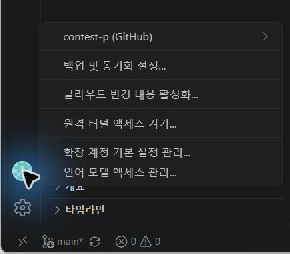
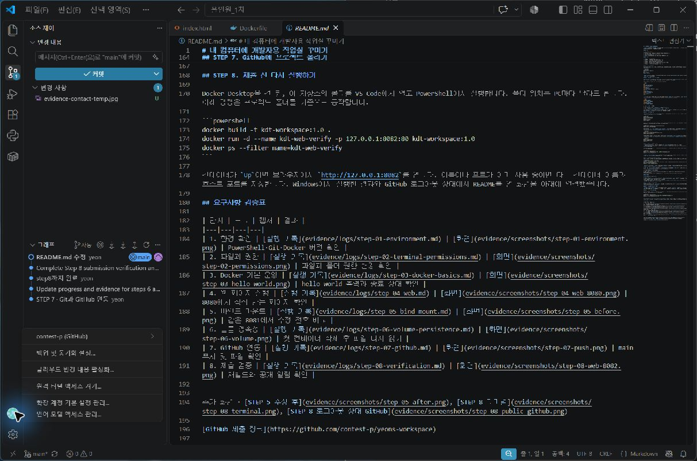

# 내 컴퓨터에 개발자용 작업실 꾸미기

올인원 1차 미션의 실습 기록입니다. Ubuntu 터미널에서 파일과 권한을 다뤄 보고, Docker로 내가 만든 웹 페이지를 실행했습니다. **STEP 1~8 실습과 제출 검증을 완료**했습니다.

## 실습 환경

| 항목 | 사용한 환경 |
|---|---|
| 운영체제와 터미널 | Windows, VS Code 내장 터미널, PowerShell 5.1 |
| 리눅스 실습 | WSL에 설치한 Ubuntu, Bash |
| Git | 2.56.0.windows.4 |
| Docker | Docker Desktop의 Linux 엔진, CLI와 서버 버전 29.9.2 |

## 진행 상황

- [x] STEP 1. 개발 환경 확인
- [x] STEP 2. 리눅스 파일 조작과 권한 변경
- [x] STEP 3. Docker 기본 명령과 컨테이너 상태 확인
- [x] STEP 4. Dockerfile로 웹 페이지 실행
- [x] STEP 5. 바인드 마운트로 HTML 수정 반영 확인
- [x] STEP 6. 컨테이너를 삭제한 뒤에도 볼륨의 파일이 남는지 확인
- [x] STEP 7. Git 설정과 GitHub 저장소 연동
- [x] STEP 8. 제출용 로그와 캡처 연결 및 최종 검증

## STEP 1. 개발 환경 확인

**목적:** 지금 어느 폴더에서 작업 중인지, 실습에 필요한 도구가 준비되어 있는지 확인합니다.

먼저 도구의 역할을 알아봅니다. **영어 풀이는 암기할 필요 없이, 명령의 역할을 이해하는 참고로 읽으면 됩니다.**

| 이름 | 쉽게 말하면 |
|---|---|
| VS Code | 코드를 작성하고 프로젝트 파일을 편집하는 프로그램입니다. |
| 터미널·PowerShell | 터미널은 명령어를 입력하는 창이고, PowerShell은 그 명령어를 받아 작업을 수행하는 도구입니다. |
| WSL·Ubuntu | WSL은 Windows에서 리눅스를 사용할 수 있게 해주는 기능입니다. 리눅스는 Windows 같은 운영체제이고, Ubuntu는 리눅스의 한 종류입니다. |
| Git | 파일을 언제, 어떻게 바꿨는지 기록하는 도구입니다. 이전 내용을 확인하거나 되돌릴 때 사용합니다. |
| Docker | 프로그램과 실행에 필요한 것들을 묶어, 다른 컴퓨터에서도 같은 방식으로 실행하기 쉽게 해주는 도구입니다. 이번 실습에서는 웹 페이지를 띄우는 데 사용합니다. |

VS Code 안의 터미널을 PowerShell로 열고 아래 명령을 실행했습니다. `#`으로 시작하는 줄은 설명이므로 함께 복사해도 괜찮습니다. **버전은 프로그램의 판 번호**로, 어떤 판이 설치되어 있는지 알려줍니다.

```powershell
# 지금 작업 중인 폴더의 위치를 확인합니다.
# Get은 '가져오다', Location은 '위치' → 현재 위치를 알려 달라는 뜻입니다.
Get-Location

# 명령어를 처리하는 도구인 PowerShell의 버전을 확인합니다.
# PS는 PowerShell, Version은 버전입니다. 저장된 정보에서 버전 항목을 봅니다.
$PSVersionTable.PSVersion

# Windows 안에 Ubuntu 같은 리눅스가 설치되어 있는지 확인합니다.
# -l은 list(목록), -v는 자세히 보기입니다.
wsl -l -v

# 파일의 변경 이력을 기록하는 Git의 버전을 확인합니다.
# --version은 '버전을 보여 줘'라는 뜻입니다.
git --version

# 웹 페이지를 실행하는 데 사용할 Docker의 버전을 확인합니다.
# Git과 같은 --version 옵션을 사용합니다.
docker --version
```

**결과 설명:** 현재 폴더 위치와 PowerShell·Git·Docker 버전을 확인했습니다. 처음에는 WSL에 설치된 리눅스가 없어서 Ubuntu를 설치했습니다. `wsl -l -v`의 `VERSION` 열에 나오는 1 또는 2는 Ubuntu의 버전이 아니라 WSL의 버전입니다.

Docker 버전이 나온다는 것은 명령어를 입력해 사용하는 도구가 설치되어 있다는 뜻입니다. 실제로 프로그램을 실행할 준비까지 되었는지는 STEP 3의 `docker info`로 추가 확인했습니다.

## STEP 2. 터미널에서 파일과 권한 다루기

**목적:** 명령어로 폴더와 파일을 만들고, 복사·이름 변경·삭제를 해 봅니다. 이어서 누가 파일을 읽고 수정할 수 있는지도 바꿔 봅니다.

**Windows 시작 메뉴에서 Ubuntu를 검색해 실행합니다.** 열린 창에서 아래 명령을 입력합니다. Bash는 이 창에서 명령을 처리하는 도구입니다. STEP 3부터는 VS Code의 PowerShell 터미널로 돌아옵니다.

| 용어 | 쉽게 말하면 |
|---|---|
| 디렉터리 | 파일을 담는 '폴더'와 같은 뜻입니다. |
| 경로 | 파일이나 폴더가 어디에 있는지 나타내는 주소입니다. |
| 홈 폴더 | 사용자 개인 폴더입니다. `~` 기호로 나타낼 수 있습니다. |
| 숨김 파일 | 보통 목록에서는 보이지 않는 파일입니다. 리눅스에서는 이름이 점(`.`)으로 시작합니다. |
| 권한 | 누가 파일을 읽거나 수정할 수 있는지 정하는 규칙입니다. |

**1. 파일과 폴더 다루기**

아래는 실습을 새 폴더에서 다시 해볼 때 사용하는 명령입니다. `kdt-step2-practice`라는 폴더가 이미 있으면 다른 이름으로 바꿔 실행합니다.

```bash
# 내 홈 폴더로 이동합니다.
# cd는 change directory(폴더 이동), ~는 내 홈 폴더를 뜻합니다.
cd ~

# 지금 작업 중인 폴더의 전체 주소를 확인합니다.
# pwd는 print working directory(현재 작업 폴더 표시)의 줄임말입니다.
pwd

# 실습용 폴더를 만듭니다.
# mkdir는 make directory(폴더 만들기)의 줄임말이고, 뒤에는 만들 이름을 적습니다.
mkdir kdt-step2-practice

# 방금 만든 실습 폴더 안으로 이동합니다.
# cd 뒤에 이동할 폴더 이름을 적습니다.
cd kdt-step2-practice

# 실습 폴더로 잘 이동했는지 현재 위치를 확인합니다.
pwd

# 권한 변경 실습에 사용할 폴더를 하나 더 만듭니다.
mkdir demo-dir

# 내용이 없는 파일 두 개를 만듭니다.
# touch는 파일이 없으면 빈 파일을 만듭니다. 점으로 시작하는 이름은 숨김 파일입니다.
touch .hidden-note empty.txt

# 문장을 note.txt 파일에 저장합니다.
# echo는 글자를 출력하고, >는 그 내용을 파일에 저장합니다.
# 같은 파일이 이미 있으면 기존 내용을 덮어씁니다.
echo "KDT terminal practice" > note.txt

# 숨김 파일까지 포함해 파일과 폴더 목록을 자세히 봅니다.
# ls는 list(목록)로 이해하면 됩니다. -l은 자세히 보기, -a는 all(숨김 항목 포함 전체)입니다.
ls -la

# note.txt에 저장된 문장을 화면에서 확인합니다.
# cat은 여기서 파일 내용을 보여 주는 명령입니다.
cat note.txt

# note.txt를 복사해서 copy.txt를 만듭니다.
# cp는 copy(복사)의 줄임말입니다. 원본 이름, 복사본 이름 순서로 적습니다.
cp note.txt copy.txt

# 복사본의 이름을 copy.txt에서 renamed.txt로 바꿉니다.
# mv는 move(이동)의 줄임말이며, 같은 폴더 안에서는 이름을 바꿀 때도 씁니다.
mv copy.txt renamed.txt

# 바뀐 파일 이름을 목록에서 확인합니다.
ls -l

# 복사본인 renamed.txt를 삭제합니다.
# rm은 remove(삭제)의 줄임말이고, -- 뒤의 내용은 옵션이 아닌 파일 이름으로 취급합니다.
rm -- renamed.txt

# 복사본이 사라지고 원본 note.txt는 남아 있는지 확인합니다.
ls -l
```

**결과 설명:** 숨김 파일과 일반 파일을 만들고, 문장 저장·복사·이름 변경·삭제를 확인했습니다. 복사본 `renamed.txt`는 삭제했고 원본 `note.txt`는 남았습니다. `mkdir`, `touch`, `cp`, `mv`, `rm`은 성공해도 화면에 별도 메시지가 나오지 않는 경우가 많아, `ls`나 `cat`으로 결과를 확인했습니다.

`pwd`에 나오는 `/home/사용자이름/kdt-step2-practice`처럼 맨 앞 `/`부터 적는 전체 주소는 **절대 경로**입니다. `note.txt`처럼 현재 폴더를 기준으로 적는 주소는 **상대 경로**입니다.

**2. 파일과 폴더의 권한 바꾸기**

권한은 **소유자(파일 주인)·그룹(사용자 묶음)·기타 사용자** 순서로 정합니다. 세 자리 숫자도 이 순서입니다. 여기서 사용자는 같은 리눅스의 계정을 뜻합니다. 예를 들어 개인 메모를 다른 계정에서 읽지 못하게 할 때 권한을 제한합니다.

| 표시 | 뜻 | 숫자 |
|---|---|---|
| `r` | read: 읽기. 파일 내용을 보거나 폴더 안의 이름 목록을 읽습니다. | 4 |
| `w` | write: 쓰기. 파일 내용을 바꾸거나 폴더 안의 항목을 추가·삭제하는 데 쓰입니다. | 2 |
| `x` | execute: 실행. 파일은 프로그램으로 실행하고, 폴더는 안으로 들어가거나 안의 파일에 접근할 때 필요합니다. | 1 |
| `-` | 해당 권한이 없습니다. | 0 |

숫자는 허용할 권한의 합입니다. **6=읽기+쓰기, 7=모든 권한, 5=읽기+실행**입니다. 폴더 안의 파일을 추가·삭제하려면 보통 `w`와 `x`가 함께 필요합니다.

```bash
# note.txt는 주인만 읽고 수정할 수 있고, 나머지는 읽기만 가능하게 합니다.
# chmod는 change mode(권한 설정 변경)의 줄임말입니다.
# 644는 소유자 6(읽기+쓰기), 그룹 4(읽기), 기타 4(읽기)입니다.
chmod 644 note.txt

# demo-dir은 주인이 읽고 변경하고 들어갈 수 있게 합니다.
# 나머지는 이름 목록을 읽고 들어갈 수 있게 합니다.
# 755는 소유자 7(읽기+쓰기+실행), 그룹과 기타는 각각 5(읽기+실행)입니다.
chmod 755 demo-dir

# 파일과 폴더에 설정된 권한을 확인합니다.
# ls의 -l은 자세히 보기, -d는 폴더 안의 목록 대신 폴더 자체의 정보를 보기입니다.
ls -ld note.txt demo-dir

# note.txt를 주인만 읽고 수정할 수 있게 바꿉니다.
# 600의 두 0은 그룹과 기타 사용자에게 권한을 주지 않는다는 뜻입니다.
chmod 600 note.txt

# demo-dir을 주인만 읽고 변경하고 들어갈 수 있게 바꿉니다.
# 700은 소유자에게 모든 권한을 주고, 그룹과 기타에는 권한을 주지 않습니다.
chmod 700 demo-dir

# 같은 명령으로 다시 확인해 권한 변경 전후를 비교합니다.
ls -ld note.txt demo-dir
```

| 대상 | 변경 전 | 변경 후 | 달라진 점 |
|---|---|---|---|
| 파일 `note.txt` | `644` → `-rw-r--r--` | `600` → `-rw-------` | 다른 사용자의 읽기 권한을 없앴습니다. |
| 폴더 `demo-dir` | `755` → `drwxr-xr-x` | `700` → `drwx------` | 다른 사용자가 목록을 보거나 들어갈 수 없게 했습니다. |

**결과 설명:** 일반적인 권한 설정상 두 항목 모두 소유자만 사용할 수 있게 바꿨습니다. 출력의 맨 앞 `-`는 일반 파일, `d`는 디렉터리(폴더)를 뜻합니다. 그 뒤의 아홉 글자는 세 글자씩 끊어서 소유자·그룹·기타 사용자의 권한을 보여 줍니다. 예를 들어 `-rw-------`는 '일반 파일이며 주인에게만 읽기·쓰기 권한이 있음'으로 읽으면 됩니다.

명령과 실제 출력은 [파일 생성·복사·목록·내용 확인 원본](evidence/screenshots/step-02-files-full.png)과 [이름 변경·삭제 및 권한 변경 전후 원본](evidence/screenshots/step-02-permissions.png)에서 확인할 수 있습니다. 스크린샷에서는 숨김 파일 이름을 처음에 `,hidden-note`로 잘못 적었다가 `.hidden-note`로 고쳤습니다.

## STEP 3. Docker 기본 운영

**목적:** Docker가 작동하는지 확인하고, 프로그램을 내려받아 실행·조회·중지하는 방법을 익힙니다.

| 용어 | 쉽게 말하면 |
|---|---|
| Docker 엔진 | 실제로 컨테이너를 만들고 실행하는 Docker의 핵심 부분입니다. |
| 이미지 | 프로그램 실행에 필요한 파일과 설정을 묶은 꾸러미입니다. |
| 컨테이너 | 이미지를 바탕으로 만든 독립된 실행 공간입니다. 같은 이미지로 여러 개를 만들 수 있습니다. |
| 프로세스 | 실행 중인 프로그램입니다. 컨테이너의 주 프로그램이 끝나면 컨테이너도 종료됩니다. |
| 로그·리소스 | 로그는 프로그램이 남긴 출력 기록이고, 리소스는 CPU·메모리 같은 컴퓨터 자원입니다. |

예를 들어 `ubuntu` 이미지 하나로 `kdt-ubuntu`, `kdt-attach-2`라는 컨테이너 두 개를 만들 수 있습니다. 같은 꾸러미로 별도의 실행 공간을 만드는 것입니다.

아래 명령은 **VS Code의 PowerShell**에서 실행합니다. Docker Desktop을 먼저 켭니다.

**1. 작동 상태 확인하고 이미지 내려받기**

```powershell
# Docker 엔진과 연결되는지, 어떤 설정으로 작동하는지 확인합니다.
# info는 information(정보)을 줄인 말로 이해하면 됩니다.
docker info

# 간단한 테스트 프로그램인 hello-world 이미지를 내려받습니다.
# pull은 '끌어오다' → 외부에서 내 컴퓨터로 가져온다는 뜻입니다.
docker pull hello-world

# hello-world 이미지로 컨테이너를 만들고 실행합니다.
# run은 '실행하다'라는 뜻입니다.
docker run hello-world

# 종료된 것까지 포함해 모든 컨테이너를 확인합니다.
# ps는 컨테이너 목록, -a는 all(전체)로 기억하면 됩니다.
docker ps -a

# Ubuntu가 들어 있는 이미지를 내려받습니다.
docker pull ubuntu

# 내 컴퓨터에 저장된 이미지 목록을 확인합니다.
docker images
```

**결과 설명:** `docker info`에서 `Server Version: 29.9.2`를 확인했습니다. `hello-world`는 인사말을 출력하고 할 일을 마쳤으므로 종료됐습니다. `Exited (0)`은 정상 종료, `Up`은 실행 중이라는 뜻입니다.

**2. 컨테이너 안에서 추가 명령 실행하기**

```powershell
# Ubuntu 컨테이너를 만들고, 계속 대기하도록 실행합니다.
# -d는 뒤에서 실행하는 옵션입니다. 실행 후에도 터미널에 다른 명령을 입력할 수 있습니다.
# --name 뒤에는 컨테이너 이름, ubuntu는 사용할 이미지 이름입니다.
# sleep은 '대기', infinity는 '무한' → 종료하지 않고 계속 기다리게 합니다.
docker run -d --name kdt-ubuntu ubuntu sleep infinity

# 실행 중인 컨테이너 안에서 Bash를 추가로 열어 명령을 입력합니다.
# exec는 execute(실행)로 이해하면 됩니다.
# -i는 입력을 받을 수 있게 하고, -t는 터미널 화면을 쓸 수 있게 합니다. 합쳐서 -it로 적습니다.
docker exec -it kdt-ubuntu bash
```

여기서부터는 **컨테이너 안의 Bash**에 입력합니다.

```bash
# 컨테이너 안의 파일과 폴더 목록을 봅니다.
ls

# 컨테이너 안에서 명령이 실행되는지 문장을 출력해 확인합니다.
echo "inside the ubuntu container"

# 추가로 연 Bash를 닫고 PowerShell로 돌아옵니다.
# exit는 '나가다'라는 뜻입니다.
exit
```

PowerShell로 돌아와 상태를 확인합니다.

```powershell
# -a 없이 쓰면 실행 중인 컨테이너만 표시합니다.
docker ps
```

**결과 설명:** 대기 중인 주 프로그램은 그대로 두고, 추가로 연 명령 창만 닫았으므로 컨테이너는 `Up`으로 유지됐습니다.

**3. 자원 사용량 확인하고 주 프로그램에 연결하기**

```powershell
# CPU·메모리 사용량을 한 번만 보여 줍니다.
# stats는 statistics(통계), --no-stream은 계속 갱신하지 말라는 뜻입니다.
docker stats --no-stream kdt-ubuntu

# 이번에는 Bash 자체를 주 프로그램으로 실행합니다.
# -dit는 위에서 배운 -d, -i, -t를 합쳐 쓴 것입니다.
docker run -dit --name kdt-attach-2 ubuntu bash

# 컨테이너에서 이미 실행 중인 주 프로그램에 연결합니다.
# attach는 '붙이다, 연결하다'라는 뜻입니다.
docker attach kdt-attach-2
```

연결된 **컨테이너의 Bash**에서 아래 명령을 입력했습니다.

```bash
# 현재 연결된 Bash에서 문장을 출력합니다.
echo "Attached to the main Bash process"

# 이번에는 주 프로그램인 Bash를 종료합니다.
exit
```

**결과 설명:** 이번에는 주 프로그램인 Bash 자체를 끝내서 컨테이너도 종료됐습니다.

| 비교 | 이번 실습에서 `exit`하면 |
|---|---|
| `exec`: 명령 창을 추가로 열기 | 추가 창만 닫힙니다. 주 프로그램인 `sleep infinity`는 계속 실행됩니다. |
| `attach`: 기존 주 프로그램에 연결하기 | 주 프로그램인 Bash가 끝나므로 컨테이너도 종료됩니다. |

**4. 출력 기록 확인하고 컨테이너 중지하기**

다시 **PowerShell**에서 실행합니다.

```powershell
# 방금 종료된 컨테이너까지 확인합니다.
docker ps -a

# 컨테이너의 주 프로그램이 남긴 출력을 확인합니다.
docker logs kdt-attach-2

# 계속 대기 중이던 Ubuntu 컨테이너를 중지합니다.
# stop은 '멈추다'입니다. 삭제는 하지 않습니다.
docker stop kdt-ubuntu

# 중지 후 상태가 Exited로 바뀌었는지 확인합니다.
docker ps -a
```

| 확인 항목 | 명령과 출력 캡처 |
|---|---|
| Docker 엔진 점검 | [docker info 명령·클라이언트](evidence/screenshots/step-03-info-client.png), [서버 응답](evidence/screenshots/step-03-info-server.png) |
| 이미지 다운로드·목록, Ubuntu 내부 명령, exec 종료 후 유지 | [docker pull·images·exec·ps](evidence/screenshots/step-03-images-exec.png) |
| 리소스, attach 종료, 로그, 중지 전후 목록 | [docker stats·attach·logs·stop·ps -a](evidence/screenshots/step-03-stats-attach-stop.png) |

## STEP 4. 직접 만든 웹 페이지 실행

**목적:** 내가 만든 웹 페이지를 Docker로 실행하고, 브라우저에서 접속해 봅니다.

| 용어 | 쉽게 말하면 |
|---|---|
| 웹 서버·NGINX | 웹 서버는 브라우저의 요청을 받아 페이지를 보내 주는 프로그램입니다. NGINX는 그런 프로그램 중 하나입니다. |
| HTML | 웹 페이지의 글과 구조를 적는 형식입니다. 이번 페이지는 `site/index.html`에 있습니다. |
| Dockerfile·빌드 | Dockerfile은 이미지를 만드는 방법을 적은 파일이고, 빌드는 그 방법에 따라 이미지를 만드는 작업입니다. |
| 포트 | 컴퓨터에서 통신할 프로그램을 구분하는 번호입니다. 접속할 '문 번호'로 생각하면 됩니다. |

사용한 [Dockerfile](Dockerfile)의 내용은 아래와 같습니다. **읽고 이해하기 위한 코드**로, 터미널에 입력하는 명령은 아닙니다.

```dockerfile
# FROM은 '무엇을 바탕으로 만들지' 정합니다.
# nginx:alpine은 NGINX가 설치된 이미지입니다. alpine은 가벼운 리눅스 기반 종류를 뜻합니다.
FROM nginx:alpine

# COPY는 '복사하다'라는 뜻입니다.
# 내 site 폴더의 파일을 웹 서버가 읽는 폴더로 복사합니다.
COPY site/ /usr/share/nginx/html/
```

페이지 원본은 [site/index.html](site/index.html)입니다. VS Code에서 프로젝트 폴더를 열고 **PowerShell**에서 아래 명령을 실행합니다. 같은 이름의 컨테이너가 이미 있다면 STEP 3의 `docker ps -a`로 상태를 먼저 확인합니다.

```powershell
# Dockerfile을 읽어 웹 페이지가 들어 있는 이미지를 만듭니다.
# build는 '만들다', -t는 tag(이름표)를 붙이는 옵션입니다.
# kdt-workspace는 이미지 이름, :1.0은 구분용 이름표입니다.
# 마지막 점(.)은 '현재 폴더의 파일을 사용해 만들어 줘'라는 뜻입니다.
docker build -t kdt-workspace:1.0 .

# 만든 이미지로 웹 서버를 뒤에서 실행하고 이름을 kdt-web으로 붙입니다.
# --name은 이름 지정, -p는 내 PC와 컨테이너의 포트 연결입니다. 숫자는 아래 표에서 풉니다.
docker run -d --name kdt-web -p 127.0.0.1:8080:80 kdt-workspace:1.0

# 실행 중인 목록에서 이름이 kdt-web에 해당하는 것만 골라 봅니다.
# --filter name=...은 이름으로 골라 보기입니다.
docker ps --filter name=kdt-web
```

**결과 설명:** `kdt-web`이 `Up`으로 표시됐고, 브라우저에서 `http://127.0.0.1:8080`으로 접속해 페이지를 확인했습니다.

| `127.0.0.1:8080:80`의 부분 | 역할 |
|---|---|
| `127.0.0.1` | 내 컴퓨터에서만 접속하도록 제한합니다. |
| `8080` | 브라우저로 접속할 내 PC의 포트입니다. |
| `80` | 컨테이너 안에서 NGINX가 기다리는 포트입니다. |

두 포트 번호는 같을 필요가 없습니다. 내 PC의 접속 번호만 `8081`, `8082`로 달리하면 웹 서버 여러 개를 구분해 열 수 있습니다.

빌드·실행 결과는 [STEP 4 실행 기록](evidence/logs/step-04-web.md), 접속 화면은 [8080 브라우저 캡처](evidence/screenshots/step-04-web-8080.png)에서 확인할 수 있습니다.

## STEP 5. 바인드 마운트로 수정 내용 확인

**목적:** 내 PC에서 웹 페이지 파일을 고쳤을 때, 이미지를 다시 만들지 않아도 브라우저에 반영되는지 확인합니다.

**바인드 마운트(bind mount)**는 내 PC(호스트)의 폴더를 컨테이너에 연결하는 기능입니다. STEP 4는 파일을 복사해 넣었고, 이번에는 **같은 원본을 함께 봅니다.** 내 `site/index.html`을 고치면 컨테이너도 바뀐 파일을 읽습니다.

프로젝트 폴더의 **PowerShell**에서 실행했습니다. 긴 실행 명령은 **이름 지정 → 포트 연결 → 폴더 연결 → 사용할 이미지** 순서로 읽으면 됩니다.

```powershell
# Resolve-Path로 site 폴더의 전체 주소를 구해 $sitePath에 보관합니다.
# .\site는 현재 폴더 안의 site, .Path는 주소 부분입니다.
$sitePath = (Resolve-Path .\site).Path

# 웹 서버를 실행하면서 내 site 폴더를 컨테이너의 웹 페이지 폴더에 연결합니다.
# --mount의 연결 내용은 아래 표에서 풉니다. 내 PC 접속 포트는 8081입니다.
docker run -d --name kdt-web-bind -p 127.0.0.1:8081:80 --mount "type=bind,source=$sitePath,target=/usr/share/nginx/html,readonly" kdt-workspace:1.0

# 이름으로 골라 웹 서버가 실행 중인지 확인합니다.
# --filter name=...은 해당 이름에 맞는 컨테이너만 보여 줍니다.
docker ps --filter name=kdt-web-bind
```

| 연결 설정 | 뜻 |
|---|---|
| `type=bind` | 내 PC 폴더를 연결합니다. |
| `source=$sitePath` | 원본은 앞에서 구한 내 `site` 폴더입니다. |
| `target=/usr/share/nginx/html` | 컨테이너의 웹 페이지 폴더에 연결합니다. |
| `readonly` | 컨테이너는 읽기만 합니다. 내 PC의 VS Code에서는 수정할 수 있습니다. |

확인은 다음 순서로 했습니다.

1. 브라우저에서 `http://127.0.0.1:8081`을 엽니다.
2. VS Code에서 `site/index.html`의 문장을 바꾸고 저장합니다.
3. **같은 8081 주소**에서 새로고침해 문장이 달라졌는지 비교합니다.

**결과 설명:** 이미지 재빌드나 컨테이너 재시작 없이 새 문장이 표시됐습니다. 컨테이너가 내 PC의 수정된 파일을 읽기 때문입니다. 아래 표의 문장은 실제 화면에 표시된 내용입니다.

| 두 번째 수정 전 | 두 번째 수정 후 |
|---|---|
| [8081 브라우저 화면](evidence/screenshots/05-before-8081.png) | [8081 브라우저 화면](evidence/screenshots/05-after-8081.png) |
| 바운드 마운트로 수정한 문장이 반영됐습니다. | 같은 컨테이너에서 두 번째 수정이 반영됨 너무 어렵다. |

## STEP 6. 볼륨에 저장한 파일 확인

**목적:** 컨테이너를 삭제해도 별도로 저장한 파일이 남는지 확인합니다.

**볼륨(volume)**은 Docker가 관리하는 별도 저장 공간입니다. 작업 공간인 컨테이너를 버려도, 별도 보관함인 볼륨은 남겨 두는 방식입니다. **컨테이너 삭제 후에도 데이터가 남는 것**을 이번에 확인하며, 이런 성질을 '영속성'이라고 합니다.

바인드 마운트는 **내 PC 폴더**, 볼륨은 **Docker가 관리하는 보관함**을 연결합니다. 이번 흐름은 **파일 저장 → 첫 컨테이너 삭제 → 새 컨테이너에서 다시 읽기**입니다.

아래는 [실습 기록](evidence/logs/step-06-volume-persistence.md)에 있는 명령입니다. **PowerShell**에서 실행했으며, 같은 이름의 볼륨·컨테이너가 없는 상태에서 진행한 기록입니다.

```powershell
# kdt-step6-data라는 별도 저장 공간을 만듭니다.
# volume은 '볼륨', create는 '만들다'라는 뜻입니다.
docker volume create kdt-step6-data

# 첫 컨테이너를 만들고, 볼륨을 안쪽의 /data 폴더에 연결합니다.
# source는 볼륨 이름, target=/data는 안쪽 연결 위치입니다. sleep infinity로 계속 대기합니다.
docker run -d --name kdt-volume-first --mount type=volume,source=kdt-step6-data,target=/data ubuntu sleep infinity

# 볼륨에 proof.txt를 저장하고, 바로 읽어 내용이 들어갔는지 확인합니다.
# bash -c는 따옴표 안을 실행합니다: echo ... > 파일(저장) && cat 파일(성공하면 읽기).
docker exec kdt-volume-first bash -c 'echo KDT-volume-proof > /data/proof.txt && cat /data/proof.txt'

# 첫 컨테이너를 중지합니다. stop은 '멈추다'입니다.
docker stop kdt-volume-first

# 중지한 첫 컨테이너를 삭제합니다. rm은 remove(삭제)입니다.
# 여기서는 컨테이너만 삭제하고 볼륨은 그대로 둡니다.
docker rm kdt-volume-first

# 종료된 것까지 포함한 목록에서 첫 컨테이너가 사라졌는지 확인합니다.
docker ps -a --filter name=kdt-volume-first

# 새 컨테이너에 같은 볼륨을 연결하고, 이전 파일을 읽습니다.
# 앞부분은 새 컨테이너와 볼륨 연결, 마지막 cat ...은 그 안에서 할 작업입니다.
docker run --name kdt-volume-second --mount type=volume,source=kdt-step6-data,target=/data ubuntu cat /data/proof.txt
```

**결과 설명:** 첫 컨테이너에서 파일을 저장한 직후와 새 컨테이너에서 읽었을 때 모두 `KDT-volume-proof`가 출력됐습니다. 첫 컨테이너 삭제 후 목록에는 열 제목만 나왔습니다. **컨테이너는 삭제됐지만 파일은 볼륨에 남아 있었다**는 것을 확인했습니다. 새 컨테이너는 파일을 읽는 작업을 마치면 정상 종료됩니다.

실제 명령과 출력은 [볼륨 삭제 전후 비교 캡처](evidence/screenshots/step-06-volume.png)에서 확인할 수 있습니다.

## STEP 7. GitHub에 프로젝트 올리기

**목적:** 작업 내용을 Git으로 기록하고, GitHub에 올려 저장소 링크로 확인할 수 있게 합니다.

| 용어 | 쉽게 말하면 |
|---|---|
| Git·GitHub | Git은 내 컴퓨터에서 파일 변경 이력을 기록하는 도구이고, GitHub는 그 기록과 파일을 온라인에 올려 공유하는 서비스입니다. |
| 저장소(repository) | 프로젝트 파일과 변경 이력을 함께 관리하는 공간입니다. |
| 로컬·원격 | 로컬은 내 컴퓨터, 원격은 GitHub처럼 네트워크로 연결된 다른 곳을 뜻합니다. |
| 커밋(commit) | 특정 시점의 작업 내용을 설명과 함께 기록하는 것입니다. |
| 브랜치(branch) | 변경 이력을 이어 가는 작업 흐름입니다. 이번에는 `main`이라는 이름을 사용했습니다. |
| origin·push | `origin`은 연결된 GitHub 저장소에 붙인 별명이고, push는 내 커밋을 그곳에 올리는 작업입니다. |

실습에서는 첫 커밋(`6b4ab01`)을 GitHub에 올리고 파일 목록을 확인했습니다. **파일 수정 → 기록할 파일 선택(add) → 내 컴퓨터에 기록(commit) → GitHub에 올리기(push)** 순서입니다.

처음 저장소를 만들 때 사용한 명령은 아래와 같습니다. **이미 연결된 현재 저장소에서 다시 실행할 필요는 없습니다.**

```powershell
# 현재 프로젝트 폴더를 Git으로 관리하기 시작하고, 첫 브랜치 이름을 main으로 정합니다.
# init은 initialize(초기화), -b는 branch(브랜치 이름 지정)입니다.
git init -b main
```

업로드 과정은 아래와 같습니다. **이미 Git 설정과 GitHub 연결이 끝난 저장소의 사용 예시**이며, 이번 문서 수정 중에는 실행하지 않았습니다.

```powershell
# 기록할 파일을 선택합니다. add는 '추가'입니다.
git add -- README.md Dockerfile site/

# 선택한 내용을 내 컴퓨터에 기록합니다. -m 뒤에는 변경 설명(message)을 적습니다.
git commit -m "실습 문서와 웹 페이지 정리"

# 기록한 커밋을 origin(GitHub)의 main 브랜치로 올립니다. push는 '밀어 올리다'입니다.
git push origin main
```

새 캡처를 넣었다면 해당 파일도 `git add` 대상에 포함합니다. 설정과 연결 상태는 다음 명령으로 확인합니다.

```powershell
# Git에 저장된 사용자 정보와 저장소 설정을 확인합니다.
# config는 configuration(설정), --list는 '목록으로 보여 줘'라는 뜻입니다.
# 출력 내용을 공유할 때는 이름·이메일 등 개인정보와 인증 정보가 포함됐는지 확인합니다.
git config --list

# 현재 작업 중인 브랜치 이름을 확인합니다.
# branch는 '가지', --show-current는 '현재 것을 보여 줘'라는 뜻입니다.
git branch --show-current

# 연결된 GitHub 저장소 주소를 확인합니다.
# remote는 '원격', -v는 주소까지 자세히 보기입니다.
git remote -v
```

**결과 설명:** 현재 브랜치는 `main`이고 `origin`은 제출용 GitHub 저장소에 연결돼 있습니다. `fetch`는 가져오기, `push`는 올리기 주소입니다. `origin/main`은 GitHub 쪽 `main`의 상태를 마지막으로 확인해 둔 기록입니다.

참고로 설정의 기본 이름은 `master`였지만, 이 저장소는 `-b main`으로 이름을 직접 정했습니다. 이름과 이메일을 가린 출력은 [Git 설정 실행 기록](evidence/logs/step-07-github.md)에 있습니다.

VS Code의 계정 메뉴에서 GitHub 로그인 상태도 확인했습니다. 아래 두 화면은 **계정 로그인**과 **이 프로젝트가 연결된 저장소 주소**를 각각 보여 줍니다.

| GitHub 로그인 상태 | VS Code 저장소 연동 |
|---|---|
|  |  |

## STEP 8. 제출 전 다시 실행하기

**목적:** 앞에서 만든 웹 페이지가 다시 실행되는지, GitHub 링크로 제출 자료를 볼 수 있는지 마지막으로 확인합니다.

**재빌드**는 이미지를 다시 만드는 작업입니다. 이번에는 확인용(verify) 컨테이너 `kdt-web-verify`와 포트 `8082`로 앞선 실습과 구분합니다.

Docker Desktop을 켠 뒤, 프로젝트 폴더를 VS Code에서 열고 **PowerShell**에서 실행합니다. 프로젝트 폴더의 위치는 PC마다 달라도 됩니다. 같은 컨테이너 이름이나 포트를 이미 사용 중이면 다른 이름과 내 PC의 포트 번호를 지정합니다.

```powershell
# 현재 프로젝트 파일로 이미지를 다시 만듭니다.
# build는 만들기, -t는 이미지 이름표 지정, 마지막 점(.)은 현재 폴더를 뜻합니다.
docker build -t kdt-workspace:1.0 .

# 검증용 웹 서버를 새 컨테이너로 실행합니다.
# 내 PC의 8082번을 컨테이너의 80번에 연결합니다.
docker run -d --name kdt-web-verify -p 127.0.0.1:8082:80 kdt-workspace:1.0

# 검증용 컨테이너가 실행 중인지 이름으로 골라 확인합니다.
docker ps --filter name=kdt-web-verify
```

마지막 확인 순서는 다음과 같습니다.

1. 컨테이너가 `Up`(실행 중)으로 표시되는지 확인합니다.
2. 브라우저 주소창에 `http://127.0.0.1:8082`를 입력해 페이지가 열리는지 확인합니다.
3. GitHub에서 로그아웃한 상태로 제출 링크를 열어 README와 연결된 자료를 볼 수 있는지 확인합니다.

**결과 설명:** 검증 당시 웹 페이지가 다시 열렸고, GitHub에 로그인하지 않아도 README를 읽을 수 있었습니다. 아래 검증표는 각 실습의 **명령과 출력 기록(로그)**, **실제 화면(캡처)**을 모아 둔 것입니다. 이후 로컬에서 문서를 수정한 내용은 커밋·푸시해야 GitHub 제출물에도 반영됩니다.

## 트러블슈팅

| 문제 | 원인 확인 | 해결과 결과 |
|---|---|---|
| `rm`이 `renamed.txt`를 찾지 못함 | 목록을 보니 `copy.txt`가 남아 있었음 | `mv`로 이름을 바꾼 뒤 삭제하고 목록에서 확인 |
| `docker run`에서 `pull access denied` 발생 | 빌드 결과는 `kdt-workspace:1.0`이었고 실행할 때 밑줄을 넣었음 | 이미지 이름을 맞춰 다시 실행하고 컨테이너와 브라우저 응답 확인 |
| HTML을 바꿔도 브라우저 문장이 그대로였음 | 주소창이 이미지에 복사한 파일을 제공하는 `8080`이었음 | 바인드 마운트가 연결된 `8081`에서 수정 전후 문장이 달라진 것을 확인 |

## 요구사항 검증표

| 단계 | 로그 | 캡처 | 결과 |
|---|---|---|---|
| 1. 환경 확인 | [실행 기록](evidence/logs/step-01-environment.md) | [화면](evidence/screenshots/step-01-environment.png) | PowerShell·Git·Docker 버전 확인 |
| 2. 파일과 권한 | [실행 기록](evidence/logs/step-02-terminal-permissions.md) | [화면](evidence/screenshots/step-02-permissions.png) | 파일과 폴더 권한 변경 확인 |
| 3. Docker 기본 운영 | [실행 기록](evidence/logs/step-03-docker-basics.md) | [화면](evidence/screenshots/step-03-hello-world.png) | hello-world 출력과 종료 상태 확인 |
| 4. 웹 페이지 실행 | [실행 기록](evidence/logs/step-04-web.md) | [화면](evidence/screenshots/step-04-web-8080.png) | 8080에서 직접 만든 페이지 확인 |
| 5. 바인드 마운트 | [실행 기록](evidence/logs/step-05-bind-mount.md) | [화면](evidence/screenshots/step-05-before.png) | 같은 8081에서 수정 전후 비교 |
| 6. 볼륨 영속성 | [실행 기록](evidence/logs/step-06-volume-persistence.md) | [화면](evidence/screenshots/step-06-volume.png) | 첫 컨테이너 삭제 후 파일 다시 읽기 |
| 7. GitHub 연동 | [실행 기록](evidence/logs/step-07-github.md) | [화면](evidence/screenshots/step-07-push.png) | main 푸시 및 파일 확인 |
| 8. 제출 검증 | [실행 기록](evidence/logs/step-08-verification.md) | [화면](evidence/screenshots/step-08-web-8082.png) | 재빌드와 공개 열람 확인 |


추가 화면 · [STEP 5 수정 후](evidence/screenshots/step-05-after.png), [STEP 8 터미널](evidence/screenshots/step-08-terminal.png), [STEP 8 로그아웃 상태 GitHub](evidence/screenshots/step-08-public-github.png)

[GitHub 제출 링크](https://github.com/contest-p/yeons-workspace)
